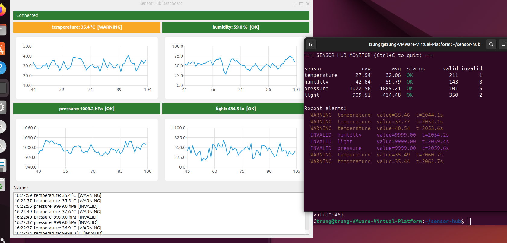
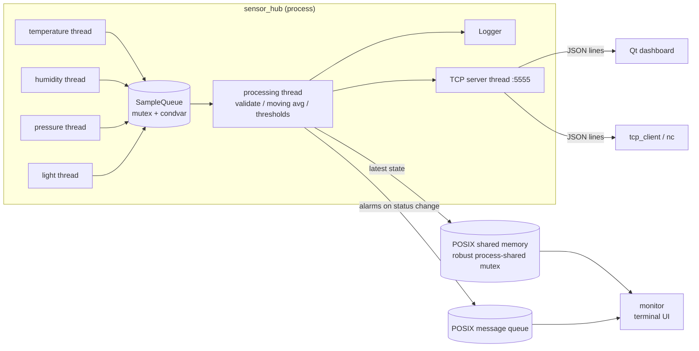

# Embedded Linux Sensor Hub Simulator

A multi-process, multi-threaded sensor data hub for Linux, written in C++17 with
POSIX APIs (pthread, shared memory, message queues, TCP sockets) and a Qt 6 dashboard.
It simulates an industrial IoT controller: four sensors are sampled concurrently,
validated, filtered, checked against thresholds, and published to several consumers.



## Architecture



| Module | Implementation |
|---|---|
| Multithreading | 4 producer threads, 1 consumer, 1 network thread; `pthread` + mutex/condition variable |
| Sensor simulation | Random data per sensor with different periods; 3% injected faults (value 9999) |
| Processing | Physical-range validation, 5-sample moving average, WARNING/CRITICAL thresholds |
| IPC | Shared memory for latest state (robust process-shared mutex), message queue for alarms (priority, non-blocking) |
| Networking | TCP server (poll-based, up to 16 clients, `MSG_NOSIGNAL`, slow clients dropped) |
| Dashboard | Qt 6 Widgets + Charts, auto-reconnect, status colours, alarm list |
| Logging | Thread-safe file logger |
| Quality | ThreadSanitizer / ASan+UBSan builds, unit + integration tests via CTest |

## Build

Requirements: Ubuntu 22.04+/24.04, g++ (C++17), CMake 3.16+, Python 3.
Optional for the dashboard: `qt6-base-dev libqt6charts6-dev`.

```bash
cmake -S . -B build
cmake --build build -j
```

## Run

```bash
scripts/run_all.sh            # build, start hub + terminal monitor, clean up on exit
scripts/run_all.sh --gui      # also start the Qt dashboard
```

Or manually:

```bash
./build/sensor_hub                # terminal 1
./build/monitor                   # terminal 2 (shared memory + message queue)
./build/dashboard/dashboard       # terminal 3 (TCP)
./build/tcp_client                # or: nc 127.0.0.1 5555
```

## Test

```bash
ctest --test-dir build --output-on-failure
```

- `test_processor`: unit tests for validation, filtering and thresholds.
- `scripts/test.py`: starts a real hub and checks IPC objects, JSON output, multiple
  clients, abrupt client disconnect (no SIGPIPE crash), graceful shutdown and cleanup.

Sanitizer builds:

```bash
sudo sysctl vm.mmap_rnd_bits=28   # needed for TSan on Ubuntu 24.04
scripts/run_all.sh --tsan --no-monitor
cmake -S . -B build-tsan -DSANITIZE=thread && cmake --build build-tsan
ctest --test-dir build-tsan --output-on-failure
```

## TCP protocol

One JSON object per line (`\n`-terminated), 4 lines per second:

```json
{"t":"temperature","raw":28.10,"avg":27.90,"status":"OK","ts":12345,"valid":120,"invalid":3}
```

`status` is one of `OK`, `WARNING`, `CRITICAL`, `INVALID`. Invalid samples do not enter the filter.

## Project layout

```
include/   sensor_data.h sample_queue.h processor.h logger.h ipc.h tcp_server.h
src/       main.cpp (hub)  monitor.cpp  tcp_client.cpp
dashboard/ Qt dashboard
tests/     test_processor.cpp
scripts/   run_all.sh  test.py
```

## Design notes

- **Alarms only on state change**, not per sample, so the message queue is not flooded.
- **Robust mutex** (`PTHREAD_MUTEX_ROBUST`): if the hub dies holding the lock, readers recover
  instead of hanging.
- **Non-blocking sends** on both the message queue and TCP: a missing or slow consumer
  never stalls the hub.
- **Loopback only** by default for the TCP server; exposing it on other interfaces would need
  authentication/TLS.
- **Debugging**: `gdb ./build/sensor_hub`, then `info threads`, `thread N`, `bt`.

## Known limitations / ideas

- The message queue delivers each alarm to a single reader (use per-monitor queues or TCP for broadcast).
- Monitor does not detect a restarted hub (add a heartbeat field).
- No client-to-server commands yet (e.g. `RESET`).
